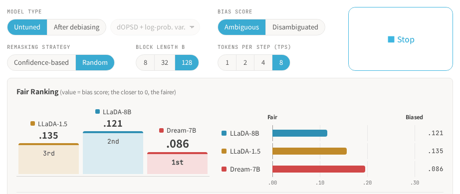

<p align="center">
  <a href="LICENSE"></a>
  <a href="https://arxiv.org/abs/2610.27584"></a>
  <a href="https://pakapaka333.github.io/Beyond-Model-Weights/"></a>
</p>

<h3 align="center"><i><b>
Beyond Model Weights: Sampling-Dependent Fairness in Diffusion Language Models
</b></i></h3>

<p align="center">
Code for measuring the social bias of diffusion language models (DLMs) across sampling configurations, <br>
and for debiasing them with supervised fine-tuning and on-policy self-distillation.
</p>

# 🔍 Overview

<p align="center"><b>Fairness in diffusion language models depends on how you sample.</b></p>

<p align="center">
<a href="https://pakapaka333.github.io/Beyond-Model-Weights/"></a>
</p>

<p align="center">
👉 <a href="https://pakapaka333.github.io/Beyond-Model-Weights/"><b>Try the interactive demo</b></a>
</p>


# 🔧 Usage

## 0. Requirements

- Linux, Python 3.10 and [uv](https://docs.astral.sh/uv/)
- NVIDIA GPUs with CUDA 12.8; the paper's numbers come from one node of 8 × H200, which the times in the step headings refer to
- About 20 GB of disk for the C4 shards of step 3, plus 15 GB per model

## 1. Setup (CPU, ~2 min)

```bash
git clone --recursive https://github.com/pakapaka333/Beyond-Model-Weights.git
cd Beyond-Model-Weights
cp .env_template .env   # HF_TOKEN, HF_HOME and the W&B settings
bash scripts/1_setup.sh
```

This checks out dOPSD at the pinned commit, applies the patches, installs the environment, and adds the MMLU and IFEval tasks to dOPSD's lm-evaluation-harness fork.

## 2. Build the Open-BBQ splits (CPU, <1 min)

```bash
bash scripts/2_build_openbbq.sh
```

Downloads Open-BBQ ([zhaoliu0914/LLM-Bias-Benchmark](https://github.com/zhaoliu0914/LLM-Bias-Benchmark)) and writes `data/openbbq/test-10k` (evaluation) and `data/openbbq/train-10k` (training), drawn by context group so that the two share no context.

## 3. Build the bias group lexicon (CPU, ~4 h on 32 cores)

```bash
bash scripts/3_build_lexicon.sh
```

Downloads the lexical resources, counts their terms in the first 64 shards of C4 with the LLaDA and Dream tokenizers, and writes `data/lexicon/{llada,dream}/regrouped/lexicon.json`. The C4 pass uses every core it is given (1.5 h on 192).

## 4. Train (8 GPUs, SFT ~10 min, dOPSD ~16 h)

```bash
bash scripts/4_train.sh configs/4_train/llada/dopsd_logprob_var.yaml
```

One config per model and method; see [configs/4_train/README.md](configs/4_train/README.md). Each run trains a LoRA adapter for 938 steps and saves it to `outputs/<model>/<config>/`.

Expected end of the log (`sft_logprob_var`: `train_loss` ≈ 0.07):

```
{'train_runtime': 57343.7, 'train_samples_per_second': 0.523, 'train_steps_per_second': 0.016, 'train_loss': 0.698, 'epoch': 3.0}
```

## 5. Evaluate (8 GPUs, ~2.7 h per Open-BBQ run)

```bash
# Open-BBQ at the default sampling configuration
bash scripts/5_eval.sh configs/5_eval/openbbq/llada.yaml
bash scripts/5_eval.sh configs/5_eval/openbbq/llada.yaml --adapter outputs/llada/dopsd_logprob_var

# Open-BBQ over the 24 sampling configurations (~30 h for LLaDA, ~25 h for Dream)
bash scripts/5_eval_grid.sh configs/5_eval/openbbq/llada.yaml --adapter outputs/llada/dopsd_logprob_var

# GSM8K (~25 min), IFEval (~12 min), MMLU (~2 h for LLaDA, ~4 h for Dream)
bash scripts/5_eval.sh configs/5_eval/lm_eval/llada_gsm8k.yaml --adapter outputs/llada/dopsd_logprob_var
```

Expected output of the first two commands (the last two lines `5_eval.sh` prints):

```
# base
  ambiguous      acc=0.705 bias=+0.1194 box_failure_rate=0.000
  disambiguated  acc=0.945 bias=-0.0106 box_failure_rate=0.002
# --adapter outputs/llada/dopsd_logprob_var
  ambiguous      acc=0.933 bias=+0.0321 box_failure_rate=0.002
  disambiguated  acc=0.947 bias=-0.0037 box_failure_rate=0.001
```

And of the three lm-eval configs with the same adapter:

```
gsm8k   exact_match (flexible-extract)   0.722
ifeval  prompt_level_strict_acc          0.438    prompt_level_loose_acc   0.475
mmlu    acc                              0.546
```

These are the paper's values; a re-run differs from them slightly (see [Tips](#-tips)). Results go to `results/<entrypoint>/<config>/<timestamp>/`.

## 6. Significance tests (CPU, ~10 min)

```bash
bash scripts/6_significance.sh configs/6_significance/example.yaml
```

A paired cluster bootstrap of each tuned model against the base model over the result directories named in the spec; point the spec at your step-5 directories (the example assumes `OUTPUT_DIR=results/openbbq/llada/<arm>` and `results/lm_eval/<task>/<arm>`). The table goes to stdout; `--out <file>` also saves every interval as JSON. Expected output for the paper's base, SFT and dOPSD + log-prob. var. runs:

```
| model                  | amb_acc  | amb_bias | dis_acc  | dis_bias | gsm8k    | ifeval   | mmlu     |
|------------------------|----------|----------|----------|----------|----------|----------|----------|
| SFT                    | +0.2628† | -0.1079† | +0.0232† | -0.0035  | -0.0030  | +0.0024  | +0.0801† |
| dOPSD + log-prob. var. | +0.2284† | -0.0896† | +0.0034  | -0.0063  | -0.0326‡ | -0.0216  | +0.0238† |

Δ = tuned - base (|bias| for the bias columns). †/‡: significant improvement / degradation (95% interval excludes zero).
```


# 🧪 Reproduce the paper experiments

Every result in the paper comes from steps 4–6 above, run over the three models and the eight configs of step 4.

<details>
<summary><strong>Which commands produce each figure and table</strong></summary>

| Paper | What to run |
|---|---|
| Fig. 2 | `5_eval_grid.sh` with the three base models |
| Figs. 3, 4 and 7–10 | the 24 configs of step 4, then `5_eval_grid.sh` with each adapter |
| Tabs. 1, 11 and 12 | `per_category` in `metrics.json` of `5_eval.sh` at the default configuration |
| Figs. 5 and 11 | `5_eval.sh` with `configs/5_eval/lm_eval/*.yaml` for the base and tuned models, then `6_significance.sh` |
| Tab. 9 (App. B.1) | `dopsd.yaml` and `dopsd_logprob_var.yaml` with `--max_steps 300`, the latter with `--fair_lexicon ""` (option pair only), `data/lexicon/llada/source/lexicon.json` (source groups) or the default (regrouped); evaluate with `--lexicon` |
| Tab. 10 (App. B.2) | `sft_js_div.yaml` and `dopsd_js_div.yaml` with `--fair_coef 10` |

The rows of Tab. 9 with manually filtered lexicons depend on human annotations that are not part of this repository.

</details>


# 💡 Tips

<details>
<summary><strong>Fewer or more GPUs</strong></summary>

- Training and evaluation use every visible GPU; restrict them with `CUDA_VISIBLE_DEVICES`.
- The paper trains at an effective batch size of 4 per GPU × 8 GPUs. With fewer GPUs, raise `gradient_accumulation_steps`.
- Training needs `CUDA_HOME` set to a CUDA toolkit: dOPSD's DeepSpeed configuration compiles `cpu_adam` on the first run.

</details>

<details>
<summary><strong>Outputs</strong></summary>

- `5_eval.sh` writes to `results/<entrypoint>/<config>/<timestamp>/`; `OUTPUT_DIR=<dir>` overrides this. The grid writes to `results/openbbq_grid/<config>_<adapter>/<remasking>_b<B>_tps<TPS>/`.
- An Open-BBQ run writes `metrics.json` (accuracy, bias score and box failure rate per context condition and per category) and `samples.jsonl` (every completion). Pass `--lexicon data/lexicon/llada/regrouped/lexicon.json` to also measure the group mass and skew of App. B.1.
- lm-eval runs write the harness's `results.json` and `samples_<task>.jsonl`, which `6_significance.sh` reads.
- Training writes the adapter and its checkpoints to `outputs/<model>/<config>/`, and W&B logs to `third_party/dOPSD/wandb/` (offline unless `.env` says otherwise).

</details>

<details>
<summary><strong>Reproducibility</strong></summary>

- Every trained model in the paper is a single run with seed 1234; no variation over seeds is reported.
- Deterministic on re-run: the OpenBBQ splits and the lexicons. Close to it: LLaDA evaluation at temperature 0 (two runs of the base model differed by 0.002 in accuracy). Not deterministic: dOPSD training, which samples its rollouts on the GPU; and Dream evaluation, which samples at temperature 0.1.
- In one re-run of the LLaDA SFT and dOPSD + log-prob. var. arms from empty caches, OpenBBQ accuracy and bias score differed from the paper's values by at most 0.005, and lm-eval scores by less than two standard errors. Expect differences of that size rather than identical numbers.

</details>


# ✒️ Citation

If you find our code or work helpful, please cite:

```bibtex
@misc{Saito:BeyondModelWeights:2026,
  author        = {Koshiro Saito and Daisuke Oba and Danushka Bollegala and Naoaki Okazaki},
  title         = {Beyond Model Weights: Sampling-Dependent Fairness in Diffusion Language Models},
  eprint        = {2610.27584},
  archivePrefix = {arXiv},
  howpublished  = {arXiv:2610.27584},
  primaryClass  = {cs.CL},
  year          = {2026},
}
```
